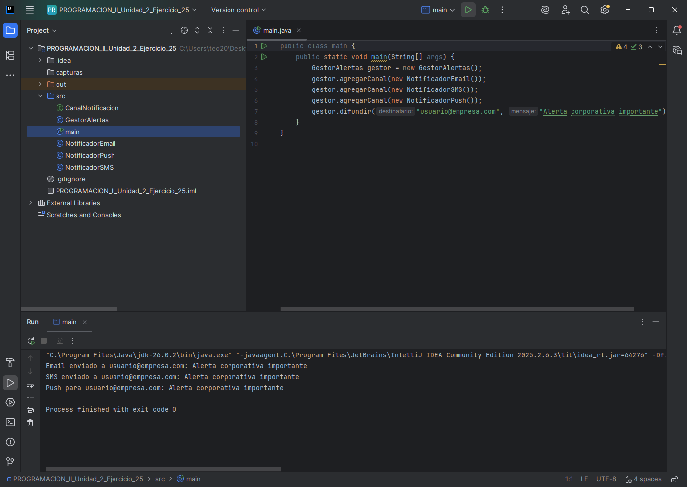

# PROGRAMACIÓN II — Unidad 2, Ejercicio 25: El Sistema de Notificaciones Omnicanal

Trabajo práctico de Programación II. Este repositorio contiene la resolución en Java del ejercicio 25 de la Unidad 2.

## Consigna

#### Contexto

Las aplicaciones modernas deben comunicarse con sus usuarios a través de múltiples canales (Correo electrónico, SMS, Notificaciones Push). Gracias a la abstracción, el sistema central puede enviar avisos importantes sin necesidad de conocer los protocolos específicos de cada proveedor de mensajería.

#### Consigna

Diseñar un modelo modular en Java donde un objeto central emita alertas utilizando una interfaz genérica de envío de mensajes.

#### Desarrollo requerido

- Definir la interfaz CanalNotificacion con el método abstracto enviar(String destinatario, String mensaje).
- Crear clases concretas como NotificadorEmail, NotificadorSMS y NotificadorPush que implementen la interfaz con sus respectivas reglas de envío.
- Desarrollar una clase GestorAlertas que contenga una lista de canales y permita difundir mensajes de manera masiva o selectiva.
- En el método main, instanciar el gestor, agregarle diversos canales de notificación y simular el envío de una alerta corporativa imprimiendo el reporte por consola.

## Estructura del repositorio

```
PROGRAMACION_II_Unidad_2_Ejercicio_25/
├── README.md
├── capturas/
│   └── consola.png
└── src/
    ├── CanalNotificacion.java
    ├── GestorAlertas.java
    ├── main.java   # clase con el método main
    ├── NotificadorEmail.java
    ├── NotificadorPush.java
    └── NotificadorSMS.java
```

## Funcionamiento y lógica

El ejercicio usa una **interfaz** para enviar una misma alerta por varios canales de notificación.

### `CanalNotificacion` (interfaz)

Define el método `void enviar(String destinatario, String mensaje)`.

### `NotificadorEmail`, `NotificadorSMS` y `NotificadorPush`

Implementan la interfaz, cada uno con su propia validación:

- **Email:** envía solo si el destinatario contiene `@`.
- **SMS:** envía solo si el destinatario tiene al menos 8 caracteres.
- **Push:** envía siempre.

### `GestorAlertas`

Guarda una lista de canales (`ArrayList<CanalNotificacion>`).

- **`agregarCanal()`:** suma un canal.
- **`difundir(destinatario, mensaje)`:** recorre la lista y le pide a cada canal que envíe el mensaje.

### `main`

Crea el gestor, le agrega los tres canales y difunde "Alerta corporativa importante" a `usuario@empresa.com`. Los tres canales cumplen su validación, así que la alerta sale por email, SMS y push.

## Ejecución

Captura de la consola de IntelliJ IDEA ejecutando el programa:



Salida obtenida:

```
Email enviado a usuario@empresa.com: Alerta corporativa importante
SMS enviado a usuario@empresa.com: Alerta corporativa importante
Push para usuario@empresa.com: Alerta corporativa importante
```
